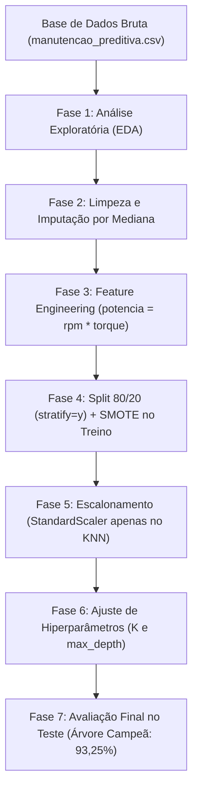

# PredictMaint PY — Sistema de Manutenção Preditiva (Indústria 4.0)

Projeto Avaliativo de encerramento do **Módulo 01 (Fundamentos de Dados, Programação e Análise Preditiva com Python)** do curso **Desenvolvimento de IA para Análise Preditiva [T4] — SENAI / Lab365**.

---

## 📌 Sobre o Software e o Problema que Resolve

O **PredictMaint PY** é um pipeline completo de Ciência de Dados e Aprendizado de Máquina (*Machine Learning*) desenvolvido em Python para atuar na **Manutenção Preditiva da Indústria 4.0**.

### O Problema
Em um parque fabril monitorado por sensores, paradas inesperadas causadas por quebras mecânicas geram altos prejuízos financeiros e interrupções na linha de produção. O desafio consiste em analisar o histórico de sensores das máquinas (temperatura do ar, temperatura de processo, velocidade de rotação, torque e tempo de desgaste da ferramenta) para **prever antecipadamente se o equipamento sofrerá uma avaria mecânica (`falha_maquina = 1`) ou continuará operando normalmente (`falha_maquina = 0`)**.

---

## 🛠️ Técnicas e Tecnologias Utilizadas

### Linguagem e Bibliotecas
- **Python 3.x**
- **Pandas & NumPy:** Manipulação tabular, limpeza de dados, estatística descritiva e engenharia de recursos (*Feature Engineering*).
- **Matplotlib & Seaborn:** Visualização de dados e geração de gráficos analíticos (countplot, histogramas, heatmap de correlação de Pearson e boxplots).
- **Scikit-Learn (`sklearn`):** Divisão estratificada de treino e teste (`train_test_split`), padronização de escala (`StandardScaler`), treinamento dos modelos classificadores (`KNeighborsClassifier` e `DecisionTreeClassifier`) e avaliação por acurácia (`accuracy_score`).
- **Imbalanced-Learn (`imblearn`):** Reamostragem e balanceamento da classe minoritária utilizando a técnica **SMOTE** (*Synthetic Minority Over-sampling Technique*).

### Fluxo do Pipeline Preditivo (Arquitetura)



### Etapas Técnicas Desenvolvidas
1. **Fase 1 — Análise Exploratória (EDA):** Inspeção das `10.000` linhas e `14` colunas, estatísticas descritivas (`.describe()`) e 3 gráficos fundamentais: distribuição da variável alvo (comprovando forte desbalanceamento de `96,61%` normais vs `3,39%` falhas), histogramas dos sensores e mapa de calor da correlação de Pearson.
2. **Fase 2 — Limpeza e Tratamento de Dados (Data Prep):** Verificação de linhas duplicadas, identificação de `500` valores nulos em 4 colunas de sensores, análise visual de *outliers* via *Boxplots* e imputação dos dados ausentes pela **Mediana** (escolhida por ser robusta aos *outliers* identificados em rotação e torque).
3. **Fase 3 — Feature Engineering:** Criação da variável física `potencia` (`velocidade_rotacao_rpm * torque_nm`) para capturar o esforço combinado exigido do motor.
4. **Fase 4 — Divisão e Balanceamento:** Remoção de colunas identificadoras e de diagnósticos pós-falha (conforme orientação do Departamento de Engenharia), divisão em **80% treino** e **20% teste** com `stratify=y` e aplicação do **SMOTE** exclusivamente nos dados de treino para evitar vazamento de dados (*Data Leakage*).
5. **Fase 5 — Escalonamento (`StandardScaler`):** Padronização das variáveis contínuas para o **KNN** (`fit_transform` no treino e `transform` no teste), mantendo os dados originais sem escalonamento para a **Árvore de Decisão** (que é imune à escala das variáveis).
6. **Fase 6 — Ajuste de Parâmetros e Combate ao Overfitting:** Testes sistemáticos no KNN (`K = 3, 5, 7`) e na Árvore de Decisão (`max_depth = 3, 5, 10, None`), identificando o sobreajuste em `max_depth = None` (`98,96%` no treino vs `93,85%` no teste) e a estabilidade em `max_depth = 10` (`94,16%` no treino vs `93,25%` no teste).
7. **Fase 7 — Avaliação Final e Veredito:** Comparação na base de teste entre o melhor KNN (`90,75%`) e a melhor Árvore de Decisão (`93,25%`), definindo a **Árvore de Decisão (`max_depth = 10`)** como modelo final para adoção na fábrica.

---

## 📁 Estrutura do Repositório

```text
Manutenção Preditiva (Indústria 4.0)/
├── data/
│   ├── manutencao_preditiva.csv                        # Base de dados histórica dos sensores
│   └── anotações do Departamento de Engenharia.docx    # Regras de negócio e dicionário de dados
├── notebooks/
│   └── pipeline_preditivo.ipynb                        # Notebook principal com todas as 7 fases
├── src/                                                # Diretório auxiliar do projeto
├── .gitignore                                          # Arquivos ignorados pelo Git
├── requirements.txt                                    # Dependências Python para reprodutibilidade
└── README.md                                           # Documentação completa do projeto
```

---

## 🚀 Como Executar o Sistema

### 1. Pré-requisitos
- Ter o **Python 3.10+** instalado em sua máquina.
- Ter o **Jupyter Notebook**, **JupyterLab** ou **VS Code** (com a extensão Jupyter) instalado.

### 2. Clonar o Repositório
```bash
git clone https://github.com/maumau220/playground.git
cd "playground/Manutenção Preditiva (Indústria 4.0)"
```

### 3. Instalar as Dependências
Instale todas as bibliotecas listadas no arquivo `requirements.txt`:
```bash
pip install -r requirements.txt
```

### 4. Executar o Notebook
Abra o arquivo `notebooks/pipeline_preditivo.ipynb` no Jupyter Notebook ou no VS Code e clique em **Run All (Executar Tudo)**. O notebook carregará automaticamente a base de dados por caminho relativo (`../data/manutencao_preditiva.csv`) e executará todas as fases sequencialmente.

---

## 📊 Resumo dos Resultados Obtidos

| Modelo | Configuração | Acurácia no Treino | Acurácia no Teste | Diagnóstico |
| :--- | :---: | :---: | :---: | :--- |
| **KNN** | `K = 3` | 95,81% | **90,75%** | Melhor configuração do KNN no teste |
| **KNN** | `K = 5` | 95,03% | 89,65% | Queda gradual de acurácia |
| **KNN** | `K = 7` | 94,31% | 88,95% | Maior suavização da fronteira |
| **Árvore de Decisão** | `max_depth = 3` | 85,04% | 89,25% | Modelo muito raso (*underfitting* leve) |
| **Árvore de Decisão** | `max_depth = 5` | 89,84% | 90,65% | Estável, porém ainda conservador |
| **Árvore de Decisão** | `max_depth = 10` | 94,16% | **93,25%** | 🏆 **Modelo Campeão (Alto acerto e sem overfitting)** |
| **Árvore de Decisão** | `max_depth = None` | 98,96% | 93,85% | Apresentou *overfitting* (decorou 98,96% do treino) |

---

## 🔮 Melhorias Futuras

1. **Avaliação com Novas Métricas (Recall, Precision e F1-Score):** Em manutenção preditiva, deixar de detectar uma falha real (Falso Negativo) custa mais caro do que um alarme falso (Falso Positivo). Incluir a Matriz de Confusão e otimizar o *Recall* da classe `1` tornará o sistema ainda mais seguro.
2. **Novas Variáveis de Engenharia (*Feature Engineering*):** Criar variáveis adicionais como a diferença de temperatura (`diferenca_temp = temperatura_processo_k - temperatura_ar_k`), ajudando a identificar falhas por dissipação de calor.
3. **Codificação da Variável `tipo`:** Transformar a variável categórica `tipo` (`L`, `M`, `H`) em números utilizando *One-Hot Encoding* ou *Ordinal Encoding* para incluí-la no treinamento.
4. **Testes com Modelos de Ensemble:** Experimentar algoritmos baseados em múltiplas árvores, como *Random Forest* e *XGBoost*, para elevar ainda mais a capacidade preditiva.

---

## 🎥 Vídeo de Apresentação do Projeto

- **Link do Vídeo (Google Drive):** *(Inserir o link público do Google Drive aqui após a gravação)* 
